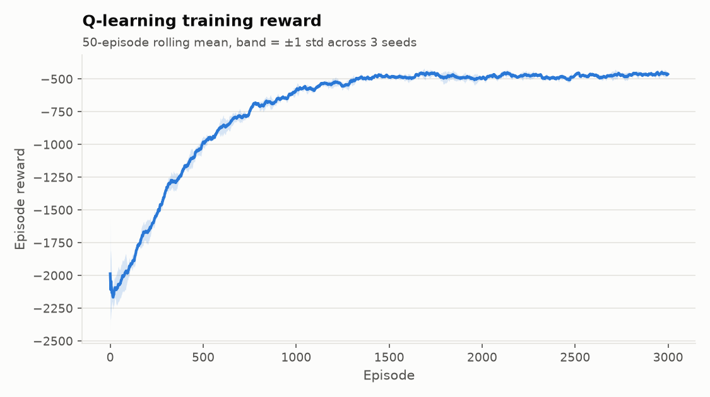
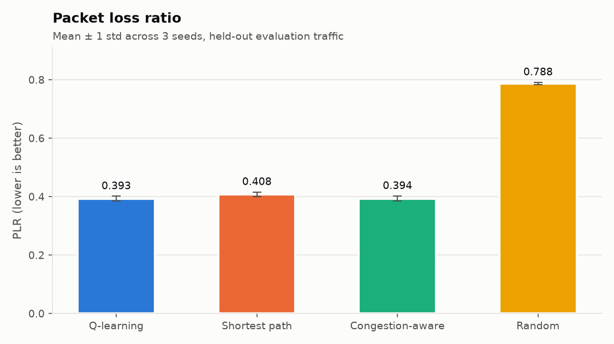
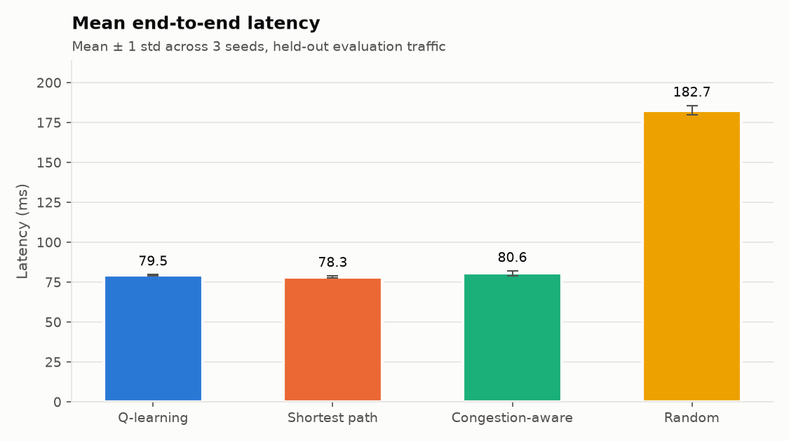
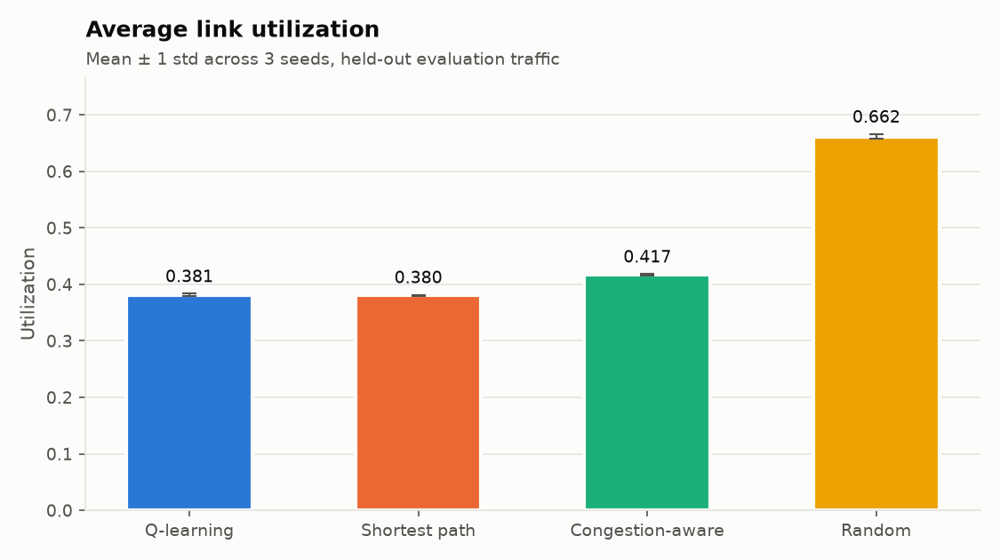
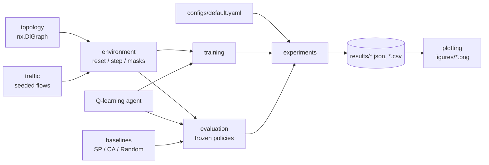

# MeshMind AI

**Adaptive network routing with tabular Q-learning, built from first principles.**

MeshMind AI trains a reinforcement-learning agent to route traffic hop by hop across a
simulated backbone network (Abilene, 12 PoPs). The agent only sees *local* congestion at
the current router. It is benchmarked against static shortest-path routing, a global
congestion-aware router, and random routing, across multiple seeds, on held-out traffic.


## Highlights

* **Q-learning from scratch:** a `dict` Q-table, an exact Bellman update, terminal-state
  handling, epsilon-greedy with decay, and an evaluation mode that is enforced as read-only.
* **Congestion-aware network simulator:** capacity, propagation latency, a quadratic
  congestion penalty above 80% utilization, proportional-sharing packet loss, and load decay.
* **Reproducible research protocol:** 3 seeds, disjoint train/eval scenarios, paired
  comparison on identical traffic, mean ± std aggregation, and every result regenerated
  from one command.
* **Engineering quality:** typed and validated config, a strict YAML loader, no global RNG,
  116 pytest tests (about 2 s), and `ruff check` + `ruff format` clean.

## Results

Abilene topology, `high` traffic profile (60-120 Mb/s flows), 3,000 training episodes,
100 held-out evaluation episodes (2,500 flows) per seed. Mean ± std over seeds 42, 100, 2026.

| Policy | PDR ↑ | PLR ↓ | Latency (ms) ↓ | Throughput ↑ | Link util | Failures |
|---|---|---|---|---|---|---|
| **Q-learning** | **0.607 ± 0.008** | **0.393 ± 0.008** | 79.50 ± 0.27 | **54.53 ± 0.53** | 0.382 | 0 |
| Shortest path | 0.592 ± 0.007 | 0.408 ± 0.007 | **78.30 ± 0.71** | 53.16 ± 0.45 | 0.381 | 0 |
| Congestion-aware | 0.607 ± 0.009 | 0.394 ± 0.009 | 80.62 ± 1.43 | 54.49 ± 0.54 | 0.417 | 0 |
| Random | 0.212 ± 0.004 | 0.788 ± 0.004 | 182.67 ± 2.99 | 19.09 ± 0.40 | 0.662 | 1019 ± 33 |

**What the numbers say:**

* Q-learning delivers **more traffic than shortest-path routing on every seed**
  (+1.4 to +1.6 PDR points, paired on identical traffic).
* It **matches the congestion-aware router**, which recomputes Dijkstra on live *global*
  link state at every hop. Q-learning gets there from a 3-level *local* signal, with fewer
  hops (2.54 vs 2.72), **8.5% less network-wide link utilization**, and lower latency on
  every seed.
* Under light load (`moderate`, `dynamic`) all non-random policies are within about 1-2
  points of each other. The learned policy pays off when the network is congested.

<p align="center">
  
  
</p>
<p align="center">
  
  
</p>

## Architecture



Details: [docs/architecture.md](docs/architecture.md)

## The model in brief

| | |
|---|---|
| **Link cost** | $\text{cost}_e = d_e + p_e$, with $p_e = d_e\left(\frac{\rho_e - 0.8}{0.2}\right)^2$ if $\rho_e > 0.8$, else $0$ |
| **Loss** | an overloaded link keeps a fraction $\min(1, C_e / L_e)$ of the flow (proportional sharing) |
| **State** | (current node, destination, outgoing-utilization bin ∈ {0: <0.5, 1: <0.85, 2: ≥0.85}) |
| **Actions** | unvisited outgoing neighbours (loop-free masking); an invalid next hop gives -100 and ends the flow |
| **Reward** | $-0.1 \cdot \text{cost} - 50 \cdot \text{dropped fraction}$, +10 on delivery, -100 on loop/dead end/hop cap |
| **Update** | $Q(s,a) \leftarrow Q(s,a) + \alpha\,[\,r + \gamma (1-\text{done}) \max_{a'} Q(s',a') - Q(s,a)\,]$ |
| **Metrics** | $\text{PDR} = \frac{\text{delivered demand}}{\text{offered demand}}$, $\text{PLR} = 1 - \text{PDR}$ |

The derivations, the M/M/1 justification for the penalty, and the reward-design reasoning
are in [docs/mathematical_model.md](docs/mathematical_model.md).

## Installation

Requires Python 3.11+.

```bash
git clone https://github.com/SaharHalili95/meshmind-ai.git
cd meshmind-ai
make install            # creates .venv and installs the package + dev tools
```

Or manually:

```bash
python3 -m venv .venv && source .venv/bin/activate
pip install -e ".[dev]"
```

## Quick start

```bash
python -m meshmind.cli smoke-test       # 5-second end-to-end sanity run
python -m meshmind.cli experiments      # full 3-seed benchmark (~20 s) + figures
python -m meshmind.cli plot             # regenerate figures from results/

python -m meshmind.cli train --seed 42 --output results/q_table.json
python -m meshmind.cli evaluate --q-table results/q_table.json --seed 42
```

All commands accept `--config path.yaml`. To run a different scenario, copy
`configs/default.yaml` and change the topology (`small_grid` | `abilene`), the traffic
profile (`low` | `moderate` | `high` | `dynamic`), the reward weights, or the agent
hyperparameters.

## Testing

```bash
make test      # or: python -m pytest
make lint      # ruff check + ruff format --check
```

| Test module | Covers |
|---|---|
| `test_topology.py` | construction, attributes, penalty formula, load updates/decay/cap, invalid + disconnected graphs |
| `test_traffic.py` | profile ranges, seed determinism, src != dst |
| `test_environment.py` | reset reproducibility, observations, action masking, loop/dead-end/max-step termination, load accounting, loss |
| `test_metrics.py` | PDR/PLR, zero-traffic safety, aggregation |
| `test_baselines.py` | shortest path on known weights, congestion avoidance, random seed reproducibility |
| `test_agent.py` | exact Bellman arithmetic, terminal zero-bootstrap, valid-action max, epsilon decay, eval read-only |
| `test_training.py` | episode limits, reward ↑, TD error ↓, determinism |
| `test_evaluation.py` | Q-table unchanged by evaluation, structured metrics, held-out seeds |
| `test_experiments.py` | config loading, full pipeline + figures, CLI commands |

## Project layout

```
meshmind-ai/
├── configs/default.yaml          experiment configuration
├── docs/                         architecture, math, methodology, interview guide
├── results/                      summary.json, per-seed + training CSVs, figures/
├── scripts/run_experiments.py    benchmark entry point
├── src/meshmind/                 package (topology → environment → agent → experiments)
└── tests/                        pytest suite
```

## Documentation

* [Architecture](docs/architecture.md): components, data flow, contracts
* [Mathematical model](docs/mathematical_model.md): network model, M/M/1 proxy, MDP, Q-learning
* [Experiment methodology](docs/experiment_methodology.md): seeds, train/eval split, aggregation, full results
* [Interview guide](docs/interview_guide.md): trade-offs, failure cases found during development, scaling limits
* [Learning hub (Hebrew)](docs/learning/README.md): project planning, C4/UML architecture diagrams, 20 troubleshooting cases, exercises

## Limitations

This is a flow-level simulator: flows are routed sequentially, and there are no packets,
queues or TCP dynamics. The state space is deliberately small so that a table works.
Moving to real networks would need function approximation (e.g. GNNs), delayed and noisy
telemetry, and safety guardrails. See the [interview guide](docs/interview_guide.md#6-scaling-limits-to-real-systems).

## License

MIT, see [LICENSE](LICENSE).
