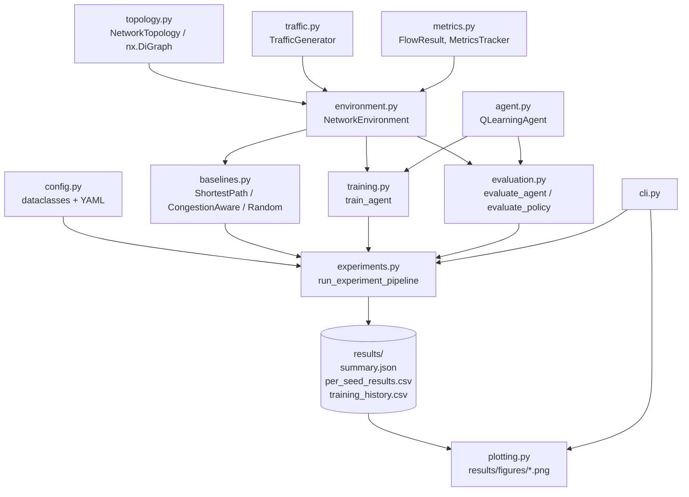
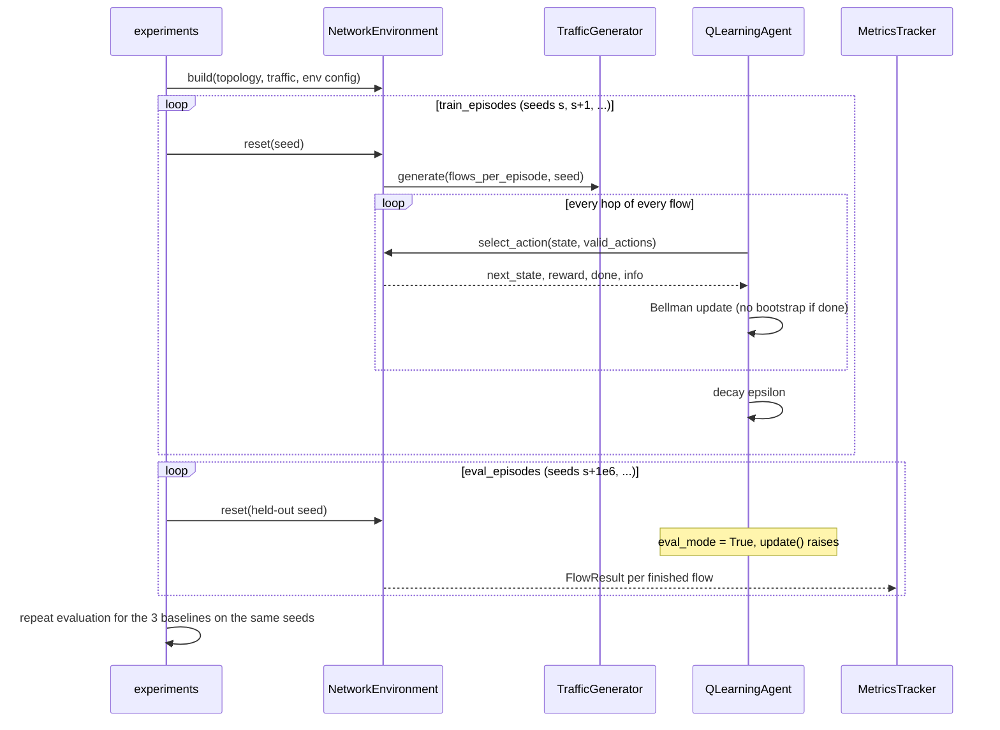

# Architecture

MeshMind AI is a small, layered simulator plus learning stack. Every layer depends only on
the layers below it, so there are no import cycles and each piece can be tested on its own.

## Component diagram

## Module dependency layers

| Layer | Modules | Depends on |
|---|---|---|
| 0: primitives | `config`, `topology`, `traffic`, `metrics` | numpy, networkx, pyyaml |
| 1: simulation | `environment` | layer 0 |
| 2: policies | `agent`, `baselines` | layer 0-1 (the agent depends only on `config`) |
| 3: loops | `training`, `evaluation` | layers 0-2 |
| 4: orchestration | `experiments`, `plotting` | layers 0-3, pandas, matplotlib |
| 5: interface | `cli`, `scripts/run_experiments.py` | everything |

`QLearningAgent` does not import the environment. It only sees hashable states and lists of
integer actions, so you could move it to another environment unchanged.

## Data flow for one benchmark seed

## Component boundaries and contracts

**`NetworkTopology`** owns all link state. It is the only thing that changes `load`,
`utilization` and `congestion_penalty`, and it recomputes the derived fields on every load
change, so they can't drift apart. It raises `ValueError` on bad inputs: an empty topology,
a self-loop, a duplicate link, capacity <= 0, latency < 0, or a graph that isn't strongly
connected (unless `require_connected=False`).

**`TrafficGenerator`** is a pure function of `(profile, seed)`. It owns its own
`np.random.default_rng`, so it shares no global random state with the agent or the
baselines.

**`NetworkEnvironment`** exposes the Gym-style API:

| Method | Contract |
|---|---|
| `reset(seed=None, flows=None)` | clears loads and samples (or replays) a flow batch; returns the first state |
| `get_observation()` | `(current_node, destination, utilization_bin)` |
| `get_valid_actions(state)` | outgoing neighbours not yet visited by the active flow (all neighbours at a dead end) |
| `step(action)` | `(next_state, reward, done, info)`; `info["flow_result"]` holds the `FlowResult` when `done` |

`done` marks the end of a **flow**, which is the RL episode boundary for bootstrapping.
`env.episode_done` marks the end of the whole flow batch.

**Policies** (the three baselines) implement
`select_action(env, state, valid_actions) -> int` and `reset(seed)`. The agent is wrapped
into the same callable shape by `evaluate_agent`. This lets `run_policy` roll out every
method through exactly the same loop on exactly the same traffic.

**Train/eval separation** is enforced in code, not just by convention.
`QLearningAgent.update` raises `RuntimeError` while `eval_mode` is on, and `evaluate_agent`
turns `eval_mode` on and restores it in a `finally` block.

## Outputs

| File | Content |
|---|---|
| `results/summary.json` | config snapshot + mean/std per policy per metric |
| `results/per_seed_results.csv` | one row per `(seed, policy)` with every metric |
| `results/training_history.csv` | one row per `(seed, episode)`: reward, TD error, epsilon, PDR, ... |
| `results/q_table_seed*.json` | learned Q-tables (git-ignored) |
| `results/figures/*.png` | reward curve + four comparison charts |
