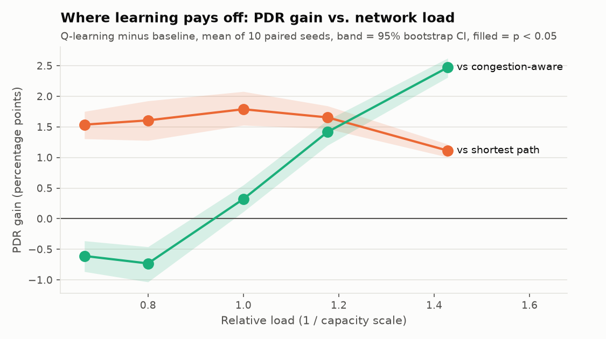

# Experiment Methodology

## Research question

Can a tabular Q-learning agent that only sees *local* congestion (a 3-level utilization bin
at the current router) match or beat routing policies that need global, real-time link
state, while delivering more traffic than static shortest-path routing?

## Setup (defaults in `configs/default.yaml`)

| Parameter | Value |
|---|---|
| Topology | Abilene (12 PoPs, 15 bidirectional links, 30 directed edges) |
| Traffic profile | `high`: demand ~ U(60, 120) Mb/s, uniform random src != dst |
| Flows per episode | 25, routed sequentially; load decay 0.85 between flows |
| Hop cap | 20 |
| Training | 3,000 episodes (75,000 flows) per seed |
| Evaluation | 100 held-out episodes (2,500 flows) per seed and policy |
| Seeds | 42, 100, 2026, 7, 13, 21, 314, 777, 1234, 9001 |
| Agent | alpha = 0.1, gamma = 0.95, epsilon 1.0 -> 0.05, decay 0.998/episode |

## Multi-seed protocol

For each of the 10 seeds $s$, independently:

1. Build a fresh topology (all loads zero), traffic generator and environment.
2. Create a fresh `QLearningAgent(seed=s)`. Its exploration RNG is seeded by $s$.
3. **Train** for 3,000 episodes. Episode $i$ uses traffic seed $s + i$.
4. **Evaluate** the frozen greedy agent on 100 episodes with traffic seeds
   $s + 10^6 + j$, $j = 0..99$.
5. Evaluate `ShortestPathBaseline`, `CongestionAwareBaseline` and
   `RandomRoutingBaseline(seed=s)` on **the same 100 held-out episodes**.

The seed controls every source of randomness: traffic, exploration, and random routing.
Re-running the pipeline reproduces `per_seed_results.csv` bit for bit. The test suite
checks this property for both training and evaluation.

## Train/evaluation split

* **Disjoint scenarios:** training seeds are $[s, s + 3000)$ and evaluation seeds
  are $[s + 10^6, s + 10^6 + 100)$. These ranges never overlap for any seed in the study
  (`test_eval_scenarios_are_held_out`), so the agent is never scored on a traffic matrix it
  trained on.
* **Frozen policy:** `evaluate_agent` turns on `eval_mode`, which forces $\epsilon = 0$
  and makes `QLearningAgent.update` raise `RuntimeError`. A test deep-copies the Q-table
  before evaluation and asserts it is unchanged afterwards.
* **Paired comparison:** all four policies are scored on identical flow sequences, so
  differences between them come from routing decisions, not from luckier traffic.

## Metrics and aggregation

Per `(seed, policy)` one `MetricsTracker` collects all 2,500 evaluated flows and reports:

* **PDR / PLR**: demand-weighted delivery and loss ratios
* **Mean latency (ms)**: over delivered flows, including congestion penalties
* **Mean throughput**: delivered Mb/s per offered flow
* **Average link utilization**: mean over all 30 edges, sampled at the end of every flow
* **Routing failures**: flows ending in an invalid action, a loop/dead end, or the hop cap

Across seeds, `aggregate_metrics` reports the **mean and sample standard deviation**
(`ddof=1`).

## Significance testing (`src/meshmind/stats.py`)

Because every policy runs on the same traffic, the unit of analysis is the per-seed
difference $d_s = m_s^{\text{QL}} - m_s^{\text{baseline}}$ for a metric $m$.

* **Exact sign-flip permutation test.** Under $H_0$ (no difference) each $d_s$ is equally
  likely to be positive or negative. Enumerating all $2^n$ sign patterns gives the exact
  null distribution of $|\bar d|$, and the two-sided p-value is the share of patterns at
  least as extreme as the observed one. No normality assumption and no SciPy.
* **Percentile bootstrap CI.** 10,000 resamples of the $d_s$ with replacement give a 95%
  interval for the mean difference.
* **Wins:** the number of seeds on which Q-learning was better (higher PDR, lower latency
  or utilization).

The smallest attainable p-value is $2 / 2^n$. With $n = 3$ that is 0.25, so **no 3-seed
experiment can ever be significant**, however consistent it looks. This is why the study
uses 10 seeds ($2/1024 \approx 0.002$).

## Results (10 seeds, mean ± std)

| Policy | PDR | PLR | Latency (ms) | Throughput | Link util | Failures |
|---|---|---|---|---|---|---|
| **Q-learning** | **0.611 ± 0.008** | **0.389 ± 0.008** | 77.92 ± 1.68 | **54.94 ± 0.57** | **0.379 ± 0.005** | 0 |
| Shortest path | 0.594 ± 0.008 | 0.406 ± 0.008 | **77.41 ± 1.53** | 53.33 ± 0.55 | 0.379 ± 0.004 | 0 |
| Congestion-aware | 0.608 ± 0.008 | 0.392 ± 0.008 | 79.43 ± 1.58 | 54.65 ± 0.53 | 0.416 ± 0.004 | 0 |
| Random | 0.217 ± 0.006 | 0.783 ± 0.006 | 183.89 ± 4.21 | 19.49 ± 0.52 | 0.663 ± 0.006 | 986 ± 31 |

### Paired comparisons (Q-learning minus baseline, n = 10)

| Metric | vs | Mean diff | 95% CI | p | Wins |
|---|---|---|---|---|---|
| PDR | shortest path | **+1.79 pts** | [+1.53, +2.08] | **0.002** | 10/10 |
| Latency | shortest path | +0.51 ms | [−0.14, +1.12] | 0.168 | 3/10 |
| Link utilization | shortest path | +0.05 pts | [−0.06, +0.16] | 0.416 | 3/10 |
| PDR | congestion-aware | **+0.32 pts** | [+0.11, +0.55] | **0.006** | 9/10 |
| Latency | congestion-aware | **−1.51 ms** | [−2.07, −0.91] | **0.006** | 9/10 |
| Link utilization | congestion-aware | **−3.65 pts** | [−3.74, −3.57] | **0.002** | 10/10 |

* **vs shortest path:** significantly more traffic delivered on every seed, with no
  significant cost in latency or utilization (both CIs contain 0).
* **vs congestion-aware:** Q-learning wins on all three metrics. The congestion-aware
  router reaches a similar delivery by taking longer detours (2.72 vs 2.53 mean hops),
  so Q-learning uses 8.8% less network-wide utilization and has 1.5 ms lower latency.
* With the original 3 seeds the congestion-aware comparison looked like a tie (+0.02 to
  +0.07 pts); only the 10-seed paired test could show that the small gap is real.
* Random routing is a sanity floor: even with loop masking, about 39% of its flows end in
  a dead end.

### Load sweep: where learning pays off

`make sweep` repeats the whole 10-seed benchmark with every link capacity scaled by
1.5, 1.25, 1.0, 0.85 and 0.7, i.e. relative load 0.67 to 1.43 (same traffic, smaller
network). Each cell is Q-learning's mean PDR gain, with its 95% CI and seeds won:

| Relative load | PDR (QL / SP / CA) | vs shortest path | vs congestion-aware |
|---|---|---|---|
| 0.67 | 0.864 / 0.849 / 0.870 | **+1.54** [+1.30, +1.75], 10/10 | **−0.61** [−0.87, −0.36], 0/10 |
| 0.80 | 0.763 / 0.746 / 0.770 | **+1.61** [+1.28, +1.92], 10/10 | **−0.73** [−1.03, −0.46], 0/10 |
| 1.00 | 0.611 / 0.594 / 0.608 | **+1.79** [+1.53, +2.08], 10/10 | **+0.32** [+0.11, +0.55], 9/10 |
| 1.18 | 0.491 / 0.474 / 0.477 | **+1.65** [+1.47, +1.84], 10/10 | **+1.42** [+1.20, +1.61], 10/10 |
| 1.43 | 0.360 / 0.349 / 0.335 | **+1.11** [+1.00, +1.22], 10/10 | **+2.47** [+2.31, +2.62], 10/10 |

Every cell is significant (p ≤ 0.006). Two clear patterns:

* **Against shortest path the gain is positive at every load.** Learning to steer around
  hot links always helps compared with ignoring them.
* **Against congestion-aware there is a crossover near load 0.9.** At light load the
  router with live global state is slightly better (−0.6 to −0.7 pts): congestion is rare
  and short-lived, so recomputing Dijkstra on exact link loads wins over a 3-bin local
  signal. As load rises, the congestion-aware router's long detours start to congest other
  links, while the learned policy keeps routes short, and the gap grows to +2.5 points.

The 1.0 row reproduces the main benchmark exactly, which is a check that the runs are
deterministic.



### Honest scope

* The congestion-aware baseline is strong: it recomputes Dijkstra with live global link
  state at **every hop**. At the benchmark load the margin over it is small (+0.32 PDR
  points), and below load 0.9 it is the better policy.
* The 10 seeds share one topology and one traffic model; they measure variability of
  training and traffic, not generalisation to other networks.
* These results are from a flow-level simulator, not packet-level emulation. See the
  interview guide for the limits.

## Reproducing

```bash
make install
make experiments          # ~1 min: 10 seeds, significance tests, results/ and figures
make sweep                # ~6 min: the same at 5 load levels
make test                 # 130 tests
```

You can override any parameter by copying `configs/default.yaml` and passing
`--config path/to/your.yaml` to `python -m meshmind.cli experiments`.
