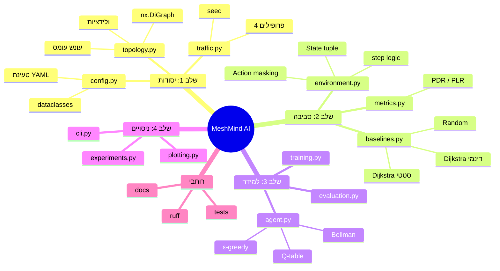
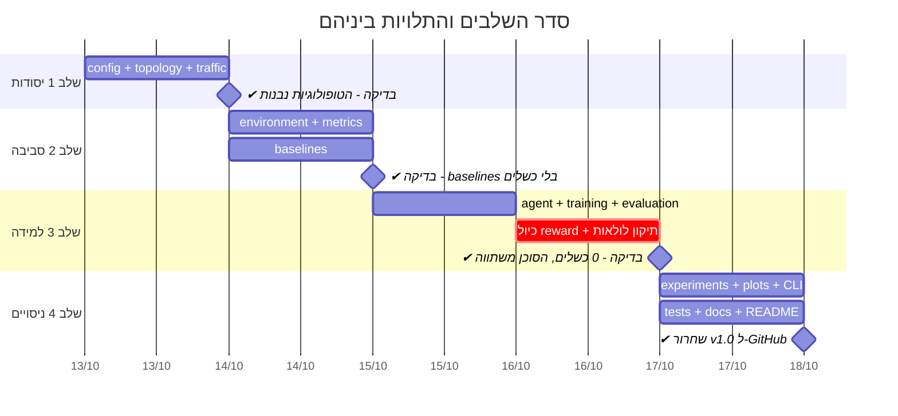
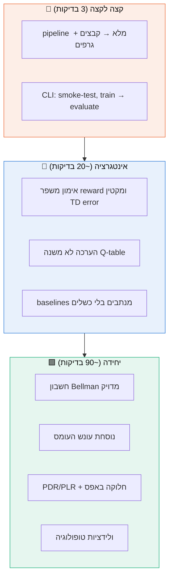

# 1️⃣ תכנון הפרויקט

> איך הופכים רעיון ("ניתוב חכם עם RL") לפרויקט מחקרי עם תוצאות שאפשר לשחזר ולהגן עליהן.

[⬅ חזרה לאזור הלמידה](README.md)

---

## 1.1 חזון ושאלת מחקר

**שאלת המחקר:**
> האם סוכן Q-learning שרואה רק עומס **מקומי** יכול להשתוות לנתב שרואה את **כל** הרשת,
> ולהעביר יותר תעבורה מניתוב סטטי לפי הנתיב הקצר ביותר?

שאלה טובה היא שאלה **שאפשר להפריך**. אם הסוכן היה מפסיד ל-shortest path, זו הייתה
תוצאה לגיטימית. לכן התוכנית בנויה סביב **השוואה הוגנת**, ולא סביב "להראות שה-RL מנצח".

---

## 1.2 דרישות

### דרישות פונקציונליות

| מזהה | דרישה | מודול | בדיקה |
|---|---|---|---|
| FR-1 | שתי טופולוגיות דטרמיניסטיות: `small_grid` (6) ו-`abilene` (12) | `topology.py` | `test_named_topologies_are_valid` |
| FR-2 | עלות קישור = latency + congestion penalty (ריבועי מעל 80%) | `topology.py` | `test_congestion_penalty_formula` |
| FR-3 | ארבעה פרופילי תעבורה עם טווחי ביקוש קבועים, src ≠ dst | `traffic.py` | `test_traffic.py` |
| FR-4 | API של סביבה: `reset / get_observation / get_valid_actions / step` | `environment.py` | `test_environment.py` |
| FR-5 | עונש ‎-100 על פעולה לא חוקית, עד 20 צעדים לזרימה | `environment.py` | `test_invalid_action_is_penalised_and_terminates` |
| FR-6 | PDR, PLR, latency, throughput, ניצולת, כשלים, בלי חלוקה באפס | `metrics.py` | `test_metrics.py` |
| FR-7 | 3 baselines: shortest path, congestion-aware, random | `baselines.py` | `test_baselines.py` |
| FR-8 | Q-learning טבלאי עם Bellman, טיפול במצב סופי ודעיכת ε | `agent.py` | `test_agent.py` |
| FR-9 | הערכה שלא משנה את ה-Q-table | `evaluation.py` | `test_evaluation_does_not_modify_q_table` |
| FR-10 | ניסוי רב-seed עם mean ± std, קבצי JSON/CSV וגרפים | `experiments.py`, `plotting.py` | `test_pipeline_writes_results_and_figures` |
| FR-11 | CLI עם 5 פקודות | `cli.py` | `test_cli_*` |

### דרישות לא-פונקציונליות

| תכונה | יעד | איך הושג |
|---|---|---|
| **שחזוריות** | אותו seed = אותן תוצאות, ביט אחר ביט | `np.random.default_rng(seed)` בכל רכיב, בלי RNG גלובלי |
| **איכות קוד** | `ruff check` + `ruff format` נקיים | `make lint` |
| **Type hints** | בכל חתימה ציבורית | חובה בכל מודול |
| **תלויות** | numpy, networkx, pandas, matplotlib, pyyaml בלבד | `pyproject.toml` |
| **מהירות** | ניסוי מלא בפחות מדקה | ~20 שניות בפועל |
| **בדיקות** | כל רכיב מכוסה | 116 בדיקות בכ-4 שניות |

---

## 1.3 פירוק העבודה (WBS)



---

## 1.4 לוח זמנים ושלבים

כל שלב נגמר ב**נקודת ביקורת** שחייבת לעבור לפני שממשיכים. כך תקלה נתפסת קרוב למקום
שבו נוצרה.



> 💡 **שימו לב לשלב המסומן באדום (`crit`):** כיול ה-reward ותיקון הלולאות לא היו בתוכנית
> המקורית. הם התגלו בבדיקת שלב 3. בפרויקטי RL זה **תמיד** קורה, ולכן כדאי לשריין זמן לכיול.

---

## 1.5 החלטות עיצוב (ADR: Architecture Decision Records)

ADR הוא תיעוד קצר של החלטה: מה היה ההקשר, מה הוחלט, ומה המחיר. ככה מראיינים
אוהבים לשמוע אותך מסביר/ה החלטות.

### ADR-1: Q-learning טבלאי ולא רשת נוירונים
* **הקשר:** 432 מצבים × עד 4 פעולות. מרחב קטן.
* **החלטה:** טבלה (`dict`).
* **למה:** ערכים מדויקים וניתנים לבדיקה, בלי שגיאת קירוב ובלי replay buffer.
* **מחיר:** לא מתרחב ל-state עשיר (למשל ניצולת לכל קישור, שזה 3³⁰ מצבים).

### ADR-2: state מקומי בלבד (עומס יוצא ממוצע, 3 דרגות)
* **הקשר:** נתב אמיתי מכיר את המונים של הממשקים שלו. מידע גלובלי מגיע באיחור.
* **החלטה:** `(current, destination, bin)`.
* **מחיר:** ממוצע מסתיר **איזה** קישור עמוס, וגודל הזרימה לא נראה.

### ADR-3: סימולציה ברמת זרימות ולא ברמת חבילות
* **הקשר:** המטרה היא החלטות ניתוב, לא דינמיקה של TCP.
* **החלטה:** כל זרימה מנותבת hop אחרי hop, ועומס דועך פי 0.85 בין זרימות.
* **מחיר:** אין תורים אמיתיים. ה-M/M/1 מופיע רק כקירוב (ראו [mathematical_model.md](../mathematical_model.md)).

### ADR-4: הסוכן לא מכיר את מחלקת הסביבה
* **החלטה:** `QLearningAgent` מקבל רק state (hashable) ורשימת פעולות (int).
* **למה:** אפשר להחליף סביבה, לבדוק את הסוכן בבידוד, ואין תלויות מעגליות.

### ADR-5: הפרדה אכיפה בין אימון להערכה
* **החלטה:** `update()` זורק `RuntimeError` כש-`eval_mode=True`, וה-seeds של ההערכה
  מוזזים ב-10⁶.
* **למה:** "לא נעדכן בזמן הערכה" כמוסכמה בלבד זה לא מספיק. הקוד צריך לאכוף את זה.

### ADR-6: חסימת לולאות (loop masking)
* **הקשר:** התגלה בשלב 3. ה-state לא זוכר את המסלול, ולכן נוצר state aliasing.
* **החלטה:** שכנים שכבר בוקרו לא מוצעים כפעולות. כניסה למבוי סתום מסיימת את הזרימה מיד.
* **פירוט:** [תקלות #13 ו-#14](03_troubleshooting.md#13--הסוכן-נכשל-בלולאות-למרות-אימון-ארוך).

---

## 1.6 ניהול סיכונים

| סיכון | סבירות | השפעה | מה עשינו |
|---|---|---|---|
| הסוכן לא לומד בכלל | בינונית | גבוהה | smoke-test על `small_grid` לפני Abilene, וגרף reward |
| reward hacking | **גבוהה** | גבוהה | בדיקת `routing_failures` בכל הרצה ← **קרה ותוקן** |
| תוצאה "טובה מדי" בגלל דליפת נתונים | בינונית | גבוהה מאוד | seeds נפרדים לאימון ולהערכה + בדיקה אוטומטית |
| baselines חלשים מדי (straw man) | בינונית | בינונית | congestion-aware עם מידע **גלובלי** ו-Dijkstra בכל hop |
| אי-שחזוריות | נמוכה | גבוהה | RNG מקומי לכל רכיב + בדיקות דטרמיניזם |
| ניסוי איטי שמאט איטרציות | נמוכה | בינונית | Python טהור עם dict. ניסוי מלא ב-20 שניות |

---

## 1.7 אסטרטגיית בדיקות



**עיקרון מנחה:** בדיקות היחידה בודקות **מספרים מדויקים** ולא רק "שזה רץ". למשל:

```python
# test_agent.py: מחשבים ידנית ומשווים
# target = -1 + 0.9 * 4 = 2.6 ; td = 0.6 ; Q = 2 + 0.5 * 0.6 = 2.3
assert agent.get_q(S, 1) == pytest.approx(2.3)
```

---

## 1.8 Definition of Done

- [x] כל 11 הדרישות הפונקציונליות ממומשות ונבדקות
- [x] `pytest`: כל 116 הבדיקות עוברות
- [x] `ruff check` ו-`ruff format --check` נקיים
- [x] ניסוי 3-seeds רץ מקצה לקצה ומייצר 3 קבצים ו-5 גרפים
- [x] 0 כשלי ניתוב לסוכן בהערכה
- [x] התוצאות ב-README תואמות בדיוק ל-`results/summary.json`
- [x] תיעוד: ארכיטקטורה, מתמטיקה, מתודולוגיה, ראיונות, אזור למידה

[המשך ← ארכיטקטורה](02_architecture.md)
