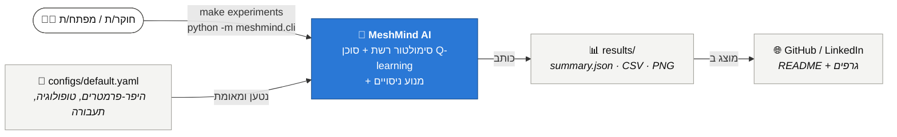
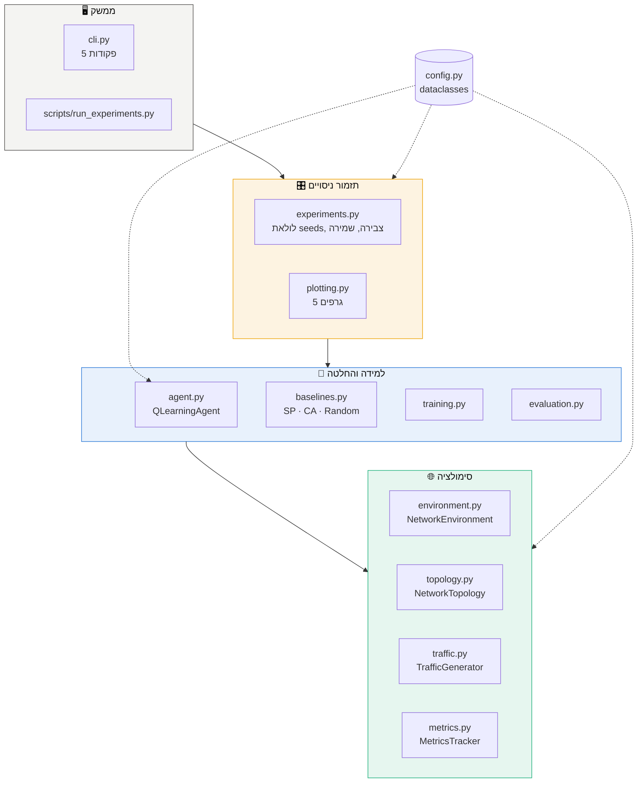
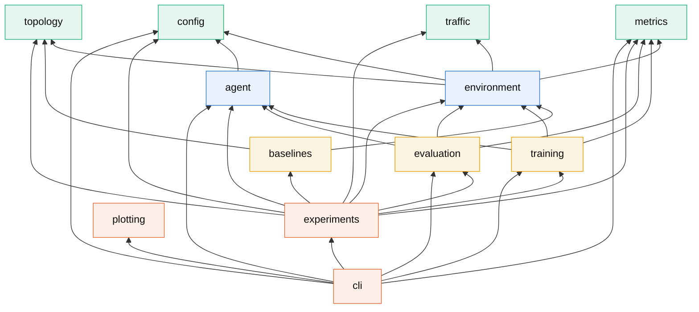
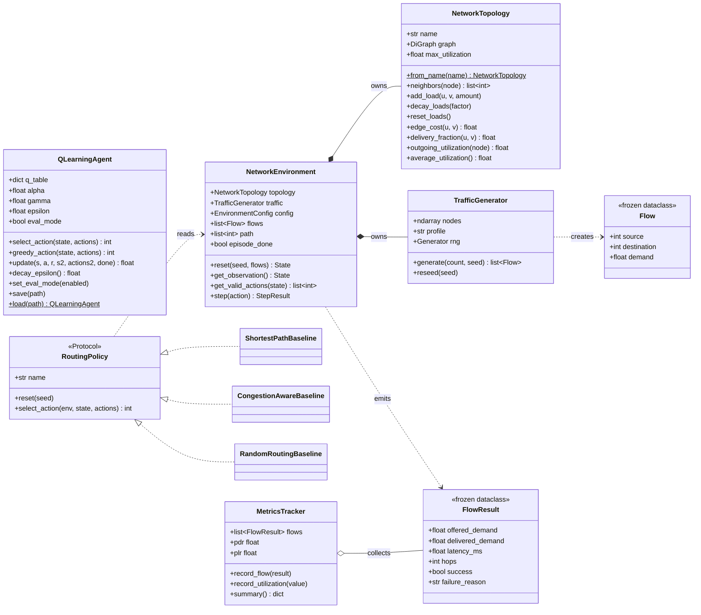
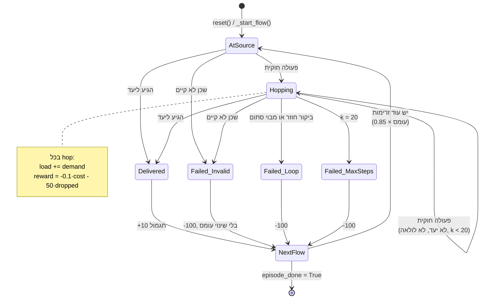
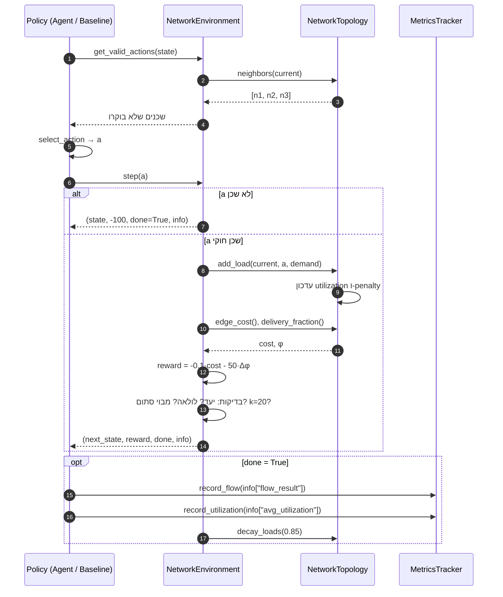
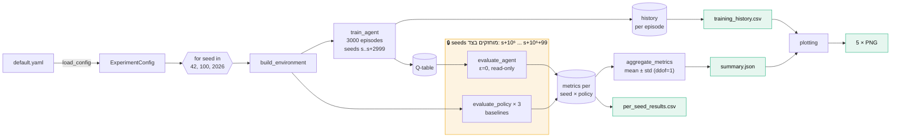
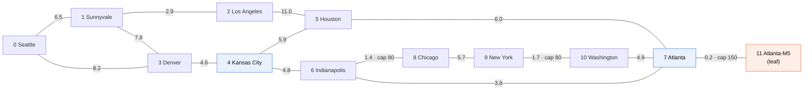

# 2️⃣ ארכיטקטורה

> ארכיטקטורה מוצגת בכמה **רמות זום**, כמו מפה. נתחיל מהתמונה הגדולה ונרד עד רמת
> המחלקה והפונקציה. השיטה נקראת **מודל C4** (Context → Containers → Components → Code).

[⬅ חזרה לאזור הלמידה](README.md)

---

## 2.1 רמה 1: הקשר המערכת (System Context)

מי משתמש במערכת, ומה נכנס ויוצא ממנה.



---

## 2.2 רמה 2: מכולות (Containers)

ארבעה "גושים" לוגיים, כל אחד עם אחריות אחת.



**כלל הזהב:** חיצים יורדים **רק למטה**. שכבה תחתונה לא מכירה שכבה עליונה. לכן אין
תלויות מעגליות, וכל שכבה נבדקת לבד.

---

## 2.3 רמה 3: גרף תלויות מדויק בין מודולים

הגרף נבנה מתוך שורות ה-`import` בקוד:



> 💡 שימו לב ש-`agent` תלוי **רק** ב-`config`. זה מה ש-ADR-4 מבטיח: הסוכן נייד לגמרי.
> `plotting` לא תלוי באף מודול פנימי. הוא קורא רק קבצים מהדיסק.

---

## 2.4 רמה 4: דיאגרמת מחלקות (UML)



### דפוסי עיצוב (Design Patterns) בפרויקט

| דפוס | איפה | למה |
|---|---|---|
| **Strategy** | `RoutingPolicy` + 3 baselines | אותה לולאת הערכה (`run_policy`) לכל מדיניות |
| **Adapter** | `evaluate_agent` עוטף את הסוכן ב-`act()` | הסוכן לא מכיר את `env`, אבל נכנס לאותה לולאה |
| **Factory method** | `NetworkTopology.from_name()` | יצירת טופולוגיה מוכרת לפי שם |
| **Value Object** | `Flow`, `FlowResult`, כל ה-Configs (`frozen=True`) | אי-שינוי: אי אפשר לשנות בטעות תוצאה שכבר נרשמה |
| **Protocol (duck typing)** | `RoutingPolicy` | חוזה מפורש בלי ירושה |

---

## 2.5 מחזור החיים של זרימה (State Machine)

כל זרימה עוברת את המצבים האלה בתוך `env.step()`:



---

## 2.6 רצף פעולות: צעד אחד (`step`)



---

## 2.7 זרימת נתונים: ניסוי מלא



---

## 2.8 הטופולוגיה: רשת Abilene

רשת Abilene הייתה רשת ה-backbone האקדמית של ארה"ב (Internet2). המספרים על הקישורים
הם השהיית התפשטות במילישניות.



* **צמתים כחולים** הם צמתי מעבר מרכזיים (degree 3-4), שם הסוכן מקבל את ההחלטות
  המשמעותיות.
* **הצומת הכתום** הוא עלה (leaf) עם שכן אחד בלבד. הוא היה המקור לתקלה #14.
* קיבולת ברירת המחדל היא 100. קישורים עם קיבולת אחרת מסומנים.

---

## 2.9 מבנה הקבצים: מי אחראי על מה

```
meshmind-ai/
├── configs/default.yaml          ← כל המספרים "הקסומים" במקום אחד
├── src/meshmind/
│   ├── config.py                 ← שכבה 0: dataclasses + ולידציה
│   ├── topology.py               ← שכבה 0: גרף + מצב קישורים
│   ├── traffic.py                ← שכבה 0: יצירת זרימות
│   ├── metrics.py                ← שכבה 0: חישוב מדדים
│   ├── environment.py            ← שכבה 1: MDP (state/action/reward)
│   ├── agent.py                  ← שכבה 1: Q-learning (בלי תלות בסביבה!)
│   ├── baselines.py              ← שכבה 2: מדיניות להשוואה
│   ├── training.py               ← שכבה 2: לולאת אימון
│   ├── evaluation.py             ← שכבה 2: לולאת הערכה (read-only)
│   ├── experiments.py            ← שכבה 3: תזמור רב-seed
│   ├── plotting.py               ← שכבה 3: גרפים מקבצים
│   └── cli.py                    ← שכבה 4: ממשק משתמש
├── tests/                        ← בדיקה לכל מודול + conftest משותף
├── docs/                         ← תיעוד טכני (EN) + אזור למידה (HE)
└── results/                      ← פלטים (Q-tables לא נשמרים ב-git)
```

[⬅ תכנון](01_project_planning.md) · [המשך ← תקלות ופתרונות](03_troubleshooting.md)
