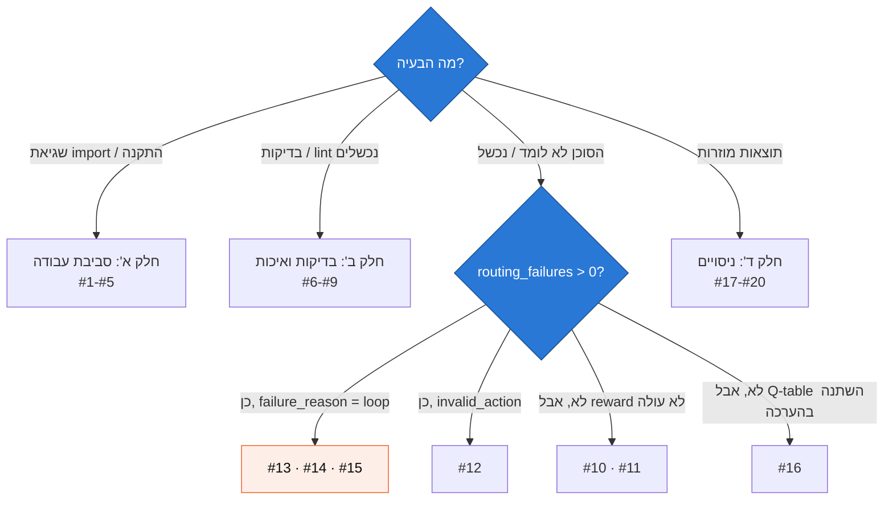
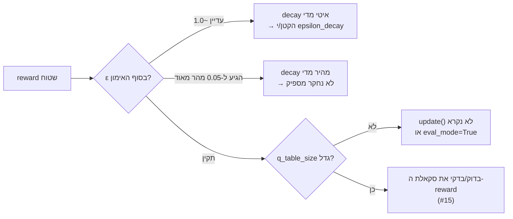
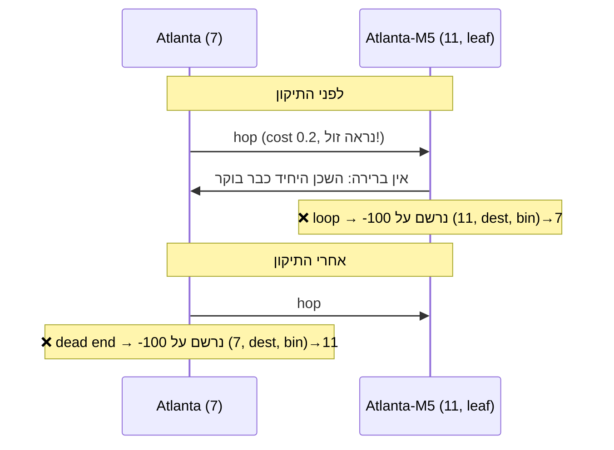

# 3️⃣ תקלות נפוצות ופתרונות

> כל תקלה בנויה באותו מבנה: **תסמין** (מה רואים) → **סיבה** → **אבחון** (איך מוודאים)
> → **פתרון** → **לקח**.
> תקלות שמסומנות ב-🔥 **קרו בפועל** במהלך פיתוח הפרויקט.

[⬅ חזרה לאזור הלמידה](README.md)

---

## מפת אבחון מהירה



**הכלי הכי שימושי לאבחון:** פירוק הכשלים לפי סיבה.

```python
from meshmind.evaluation import run_policy, eval_seeds
tracker = run_policy(env, lambda e, s, v: agent.greedy_action(s, v), eval_seeds(42, 100))
print(tracker.failure_breakdown())          # {'loop': 150}
from collections import Counter
print(Counter(f.path for f in tracker.flows if not f.success).most_common(5))
```

---

# חלק א': סביבת עבודה והתקנה

### 1. 🔥 `ModuleNotFoundError: No module named 'numpy'`

| | |
|---|---|
| **תסמין** | `python3 -c "import numpy"` נכשל, למרות ש"התקנת". |
| **סיבה** | הרצת עם ה-Python של המערכת (`/opt/homebrew/bin/python3`) ולא עם ה-venv של הפרויקט. |
| **אבחון** | `which python` מראה נתיב מחוץ ל-`.venv`. |
| **פתרון** | `source .venv/bin/activate`, או להריץ ישירות `.venv/bin/python`. ה-`Makefile` כבר משתמש ב-`.venv/bin/python`. |
| **לקח** | לכל פרויקט venv משלו. לעולם לא `pip install` ל-Python הגלובלי. |

### 2. `ModuleNotFoundError: No module named 'meshmind'`

| | |
|---|---|
| **תסמין** | `python -m meshmind.cli` נכשל מתוך תיקיית הפרויקט. |
| **סיבה** | הקוד יושב ב-`src/` (src layout), ו-Python לא מחפש שם כברירת מחדל. |
| **פתרון** | `pip install -e ".[dev]"` (מצב editable: שינויים בקוד נכנסים לתוקף מיד). לחלופין `PYTHONPATH=src`. |
| **לקח** | src layout מונע מצב שבו הבדיקות עוברות רק כי הן רצות מהתיקייה הנכונה. הוא מכריח התקנה אמיתית. |

### 3. `TypeError: zip() takes no keyword arguments` או `AttributeError: itertools has no pairwise`

| | |
|---|---|
| **סיבה** | גרסת Python ישנה. הקוד משתמש ב-`zip(strict=...)` וב-`itertools.pairwise`, שנוספו ב-3.10. |
| **אבחון** | `python --version` |
| **פתרון** | Python 3.11 ומעלה (`requires-python = ">=3.11"` ב-`pyproject.toml`, ו-`.python-version` = 3.12). |

### 4. 🔥 ההרצה הראשונה של matplotlib "תקועה"

| | |
|---|---|
| **תסמין** | `Matplotlib is building the font cache; this may take a moment.` |
| **סיבה** | בהרצה הראשונה matplotlib סורק את הפונטים במחשב. |
| **פתרון** | לחכות. זה קורה פעם אחת בלבד. |

### 5. 🔥 הפקודה `code` לא קיימת (פתיחה ב-VS Code)

| | |
|---|---|
| **תסמין** | `zsh: command not found: code` |
| **פתרון מיידי** | `open -a "Visual Studio Code" .` |
| **פתרון קבוע** | ב-VS Code: `Cmd+Shift+P` ← "Shell Command: Install 'code' command in PATH". |

---

# חלק ב': בדיקות ואיכות קוד

### 6. pytest לא מוצא את החבילה

| | |
|---|---|
| **תסמין** | `ImportError` בזמן איסוף הבדיקות. |
| **פתרון** | ב-`pyproject.toml` מוגדר `pythonpath = ["src"]` תחת `[tool.pytest.ini_options]`. ודא/י שאת/ה מריץ/ה `pytest` מתיקיית השורש. |

### 7. 🔥 `ruff check` נכשל: `RUF007 Prefer itertools.pairwise()`

| | |
|---|---|
| **קוד מקורי** | `zip(nodes, nodes[1:], strict=False)` |
| **סיבה** | ruff מזהה דפוס "זוגות עוקבים" שיש לו פונקציה ייעודית. |
| **פתרון** | `itertools.pairwise(nodes)`. אפשר גם `ruff check --fix --unsafe-fixes`, אבל **תמיד לבדוק את ה-diff** אחרי תיקון "unsafe". |
| **לקח** | linter הוא לא רק סגנון. הוא מלמד את ה-idioms של השפה. |

### 8. `ruff format --check` נכשל אחרי עריכה ידנית

| | |
|---|---|
| **פתרון** | `make format` מריץ `ruff format` ואחריו `ruff check --fix`. |
| **טיפ** | התקנ/י את תוסף Ruff ל-VS Code והפעל/י "Format on Save". |

### 9. בדיקה שעוברת לפעמים ונכשלת לפעמים (flaky)

| | |
|---|---|
| **סיבה** | אקראיות שלא מגיעה מ-seed: `np.random.random()` גלובלי, `random` של Python, או סדר של `set`. |
| **איך נמנע כאן** | לכל רכיב `np.random.default_rng(seed)` משלו. בחירת פעולה חמדנית שוברת שוויון לפי ה-id הנמוך (דטרמיניסטי). `neighbors()` מחזיר רשימה **ממוינת**. |
| **בדיקות ששומרות על זה** | `test_training_is_deterministic`, `test_evaluation_is_deterministic`, `test_same_seed_gives_identical_flows`. |

---

# חלק ג': למידה (Reinforcement Learning)

### 10. ה-reward לא עולה במהלך האימון



| | |
|---|---|
| **חישוב שימושי** | הפרק שבו ε מגיע לרצפה: `ln(ε_end/ε_start) / ln(decay)`. עם 0.998: `ln(0.05)/ln(0.998)` ≈ **1,497** פרקים, כלומר חצי מ-3,000. זה האיזון שבחרנו. |
| **אבחון** | העמודות `epsilon`, `q_table_size` ו-`mean_abs_td_error` ב-`training_history.csv`. |

### 11. TD error לא יורד

| | |
|---|---|
| **סיבה אפשרית** | α גדול מדי (הערכים "קופצים"), או סביבה לא-סטציונרית (העומס משתנה כל הזמן). |
| **מה לצפות** | ב-MeshMind ה-TD error **לא** יורד לאפס, כי α קבוע והעומס משתנה. מספיק שהוא יורד משמעותית בין 10% הראשונים ל-10% האחרונים (`test_td_error_loss_decreases`). |

### 12. כשלי `invalid_action`

| | |
|---|---|
| **סיבה** | המדיניות בחרה פעולה מחוץ ל-`get_valid_actions()`. |
| **אבחון** | `failure_breakdown()` מחזיר `{'invalid_action': N}`. |
| **פתרון** | הסוכן והבסיסים בוחרים **רק** מתוך הרשימה החוקית. אם רואים את זה, יש באג בקוד המדיניות. הסביבה מגינה על עצמה: ‎-100 בלי לשנות עומס. |

### 13. 🔥 הסוכן נכשל בלולאות למרות אימון ארוך

| | |
|---|---|
| **תסמין** | 131-166 כשלים מתוך 2,500 זרימות, כולם `loop`. אימון ארוך יותר לא עזר. |
| **סיבה: State aliasing** | ה-state `(current, dest, bin)` **לא זוכר מאיפה הגענו**. הפעולה "מ-B לך ל-A" טובה כשהזרימה התחילה ב-B, והרסנית כשהרגע הגענו מ-A. אותו מצב, שתי משמעויות. |
| **פתרון** | **Loop masking**: `get_valid_actions()` מסנן שכנים שכבר נמצאים ב-`env.path`. |

```python
unvisited = [n for n in neighbors if n not in self.path]
return unvisited or neighbors   # במבוי סתום: מחזירים הכל, והזרימה תיכשל כלולאה
```

| | |
|---|---|
| **תוצאה** | הכשלים ירדו, אבל **לא לאפס** (150). ממשיכים ל-#14. |
| **לקח** | כשה-state לא מרקובי (חסר בו מידע רלוונטי), למידה נוספת לא תעזור. צריך לשנות את ה-state או את מרחב הפעולות. |

### 14. 🔥 לולאות דרך צומת עלה (Atlanta-M5)

**אבחון:** הדפסת המסלולים שנכשלו הראתה את אותו דפוס שוב ושוב:

```
(10 → 7 → 11 → 7)   22 פעמים
(9 → 10 → 7 → 11 → 7)   21 פעמים
(7 → 11 → 7)   19 פעמים
```



| | |
|---|---|
| **סיבה** | העונש נרשם **צעד אחד מאוחר מדי**, על המצב של העלה. אבל המצב `(11, dest, bin)→7` הוא גם הצעד **הנכון** כשזרימה **מתחילה** ב-11. הממוצע של שני המקרים נראה סביר, ולכן הסוכן לא למד להימנע מהכניסה לעלה. |
| **פתרון** | כניסה לצומת שכל שכניו כבר בוקרו מסיימת את הזרימה **מיד**: `_is_dead_end(v)`. העונש נוחת על ההחלטה שגרמה לבעיה. |
| **תוצאה** | dynamic: 150 → **19** כשלים. |
| **לקח** | **Credit assignment**: העונש צריך לנחות על ההחלטה שגרמה לבעיה, לא על התוצאה הבלתי נמנעת שלה. |

### 15. 🔥 הסוכן מסובב תעבורה בלולאה בכוונה (reward hacking)

| | |
|---|---|
| **תסמין** | בפרופיל `high`: **375** כשלי לולאה, יותר מבעומס נמוך. |
| **סיבה** | עונש הלולאה היה ‎-50. מסירה דרך קישורים עמוסים עלתה יותר: latency עם עונש עומס (עד פי 12.25) ועוד עונש drop (עד ‎-50). **בשביל הסוכן, להיכשל היה משתלם.** |

```
לפני:   כישלון = -50     מסירה גרועה ≈ -(עשרות-מאות ms) - 50·drop + 10   ← לפעמים גרוע יותר!
אחרי:   כישלון = -100    מסירה גרועה ≥ -(0.1·360) - 50 + 10 ≈ -76         ← תמיד עדיף למסור
```

| | |
|---|---|
| **פתרון** | (1) `latency_weight = 0.1` כדי לנרמל את ה-latency. (2) כל עונשי הכישלון ‎-100. |
| **תוצאה** | **0 כשלים** בכל הפרופילים ובכל ה-seeds. |
| **לקח** | ה-reward חייב לקודד את **סדר העדיפויות** של המפעיל (מסירה גרועה > כישלון), ולא רק "כיוון כללי". הסוכן יעשה בדיוק מה שמתגמל אותו, לא מה שהתכוונת. |

### 16. ה-Q-table משתנה בזמן הערכה (דליפה)

| | |
|---|---|
| **סיבה טיפוסית** | קריאה ל-`agent.update()` בתוך לולאת ההערכה, או שכחה לכבות חקירה. |
| **איך נמנע כאן** | `evaluate_agent` מפעיל `eval_mode=True`, ובמצב הזה `update()` **זורק `RuntimeError`**. `try/finally` מחזיר את המצב הקודם. |
| **בדיקה** | `test_evaluation_does_not_modify_q_table` עושה `deepcopy` לפני ההערכה ומשווה אחריה. |

---

# חלק ד': ניסויים ותוצאות

### 17. כל המדיניות (חוץ מ-random) נותנות כמעט אותה תוצאה

| | |
|---|---|
| **תסמין** | ב-`moderate` ה-PDR של כולן ≈ 0.99. |
| **סיבה** | כשאין עומס, הנתיב הקצר הוא גם הטוב ביותר. אין מה לשפר. |
| **פתרון** | זו לא תקלה, זו תוצאה. לכן ברירת המחדל היא `high`, שם יש מרחב החלטה. **חשוב לדווח על זה בכנות** (ה-README עושה את זה). |

### 18. std = 0.000 בטבלה

| | |
|---|---|
| **סיבה** | רק seed אחד (למשל ב-`smoke-test`). סטיית תקן מדגמית (`ddof=1`) לא מוגדרת עבור n=1, ולכן מוחזר 0. |
| **פתרון** | הטבלה מסתירה את ה-± כשיש seed יחיד. לניסוי אמיתי משתמשים ב-10 seeds: עם n seeds ה-p-value הקטן ביותר האפשרי במבחן פרמוטציות הוא 2/2ⁿ, כלומר 0.25 עבור 3 seeds, ואז שום תוצאה לא יכולה להיות מובהקת. |

### 19. `FileNotFoundError: run experiments first`

| | |
|---|---|
| **סיבה** | `meshmind plot` רץ לפני שנוצרו `summary.json` ו-`training_history.csv`. |
| **פתרון** | `make experiments` (מייצר גם את הגרפים), או `--results-dir` לתיקייה הנכונה. |

### 20. "התוצאה טובה מדי": חשד לדליפת נתונים

| | |
|---|---|
| **מה בודקים** | האם הסוכן נבחן על אותן מטריצות תעבורה שהתאמן עליהן? |
| **איך נמנע כאן** | אימון: seeds `s .. s+2999`. הערכה: `s+10⁶ .. s+10⁶+99`. הטווחים זרים. |
| **בדיקה** | `test_eval_scenarios_are_held_out` |
| **השוואה הוגנת** | כל 4 המדיניות נבחנות על **אותן** 100 תרחישים בדיוק (paired comparison). |

---

## 📋 סיכום: 6 העקרונות שעולים מהתקלות

| # | עיקרון | תקלות |
|---|---|---|
| 1 | **סביבה מבודדת** לכל פרויקט (venv + src layout) | 1, 2, 3 |
| 2 | **כל אקראיות מגיעה מ-seed** מפורש | 9, 20 |
| 3 | **לפרק כשלים לפי סיבה** לפני שמשנים קוד | 12-15 |
| 4 | **State חייב להיות מרקובי**, אחרת יש aliasing | 13, 14 |
| 5 | **Reward = סדר העדיפויות** של המפעיל | 15 |
| 6 | **לאכוף בקוד** את ההפרדה בין אימון להערכה | 16, 20 |

[⬅ ארכיטקטורה](02_architecture.md) · [המשך ← תרגילים](04_exercises.md)
