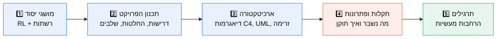

# 📚 MeshMind AI: אזור הלמידה

> אזור הלמידה מסביר **איך** ו**למה** הפרויקט בנוי כפי שהוא בנוי,
> כך שתוכל/י להסביר כל החלטה בראיון, לשחזר את הפרויקט מאפס ולהרחיב אותו.

---

## 🗺️ מסלול הלמידה המומלץ



| # | מסמך | מה תלמד/י | זמן קריאה |
|---|---|---|---|
| 1 | [מושגי יסוד](#-מושגי-יסוד-בקצרה) (בהמשך העמוד) | Q-learning, MDP, ניתוב, ניצולת קישור | 10 דק' |
| 2 | [01_project_planning.md](01_project_planning.md) | איך מתכננים פרויקט מחקרי: דרישות, החלטות עיצוב, שלבים, סיכונים | 20 דק' |
| 3 | [02_architecture.md](02_architecture.md) | ארכיטקטורה מלאה: מודל C4, דיאגרמות מחלקות, רצף, מצבים וזרימת נתונים | 30 דק' |
| 4 | [03_troubleshooting.md](03_troubleshooting.md) | 20 תקלות נפוצות (התקנה, בדיקות, RL, תוצאות), לכל אחת אבחון ופתרון | 30 דק' |
| 5 | [04_exercises.md](04_exercises.md) | תרגילי הרחבה מדורגים, עם רמזים | תלוי בך |

מסמכים טכניים משלימים (באנגלית):
[architecture.md](../architecture.md) · [mathematical_model.md](../mathematical_model.md) ·
[experiment_methodology.md](../experiment_methodology.md) · [interview_guide.md](../interview_guide.md)

---

## 🧠 מושגי יסוד בקצרה

### מה הבעיה?
ברשת תקשורת, כל "זרימה" (flow) צריכה להגיע מנתב מקור לנתב יעד. הנתיב הקצר ביותר הוא לא
תמיד הטוב ביותר: אם כולם עוברים באותו קישור, הוא **מתגודש**, ואז יש עיכוב (latency)
ואובדן חבילות (packet loss).

### מה הפתרון שלנו?
סוכן **Reinforcement Learning** שלומד, דרך ניסוי וטעייה בסימולטור, לאיזה שכן להעביר את
התעבורה בכל צומת. ההחלטה תלויה ביעד וברמת העומס המקומית.

### המושגים, במשפט אחד כל אחד

| מושג | הסבר | איפה בקוד |
|---|---|---|
| **State (מצב)** | מה הסוכן "רואה": (צומת נוכחי, יעד, דרגת עומס 0/1/2) | `environment.py` → `get_observation()` |
| **Action (פעולה)** | לאיזה שכן לשלוח את הזרימה עכשיו | `get_valid_actions()` |
| **Reward (תגמול)** | מספר שאומר לסוכן כמה טובה הייתה הפעולה (שלילי = עלות) | `step()` |
| **Q(s,a)** | הערכה: "כמה תגמול כולל אקבל אם אבצע a במצב s ואמשיך בצורה מיטבית" | `agent.py` → `q_table` |
| **Bellman update** | עדכון ההערכה לפי מה שקרה בפועל + הערכת העתיד | `agent.update()` |
| **ε-greedy** | בהסתברות ε לנסות משהו אקראי (חקירה), אחרת לבחור את הטוב ביותר (ניצול) | `agent.select_action()` |
| **Episode** | 25 זרימות ברצף. בסופו ε קטן | `training.py` |
| **Utilization (ניצולת)** | עומס ÷ קיבולת של קישור | `topology.py` |
| **PDR** | אחוז התעבורה שהגיעה ליעד | `metrics.py` |

### הנוסחה החשובה ביותר בפרויקט

```
Q(s,a) ← Q(s,a) + α · [ r + γ · max Q(s',a') − Q(s,a) ]
                        └──────── המטרה ───────┘
                       └──────────── TD error ─────────────┘
```

* **α = 0.1** (קצב למידה): כמה לזוז לכיוון המטרה בכל עדכון.
* **γ = 0.95** (מקדם היוון): כמה העתיד חשוב ביחס לעכשיו.
* כשהזרימה מסתיימת (`done=True`), אין עתיד, ולכן `max Q(s',a') = 0`.

---

## ✅ איך לבדוק שהבנת

אם תוכל/י לענות על השאלות האלה בלי להסתכל, את/ה מוכן/ה לראיון:

1. למה ה-state כולל רק את העומס **המקומי** ולא את העומס של כל הרשת?
2. מה היה קורה אם לא היינו מאפסים את `max Q(s',a')` במצב סופי?
3. למה אתחול ה-Q-table לאפס הוא "אופטימי" בפרויקט הזה?
4. מה זה reward hacking, ואיך זה קרה כאן? (רמז: [תקלה #15](03_troubleshooting.md#15--הסוכן-מסובב-תעבורה-בלולאה-בכוונה-reward-hacking))
5. איך מבטיחים שההערכה לא "מרמה", כלומר לא נבחנת על נתונים שהסוכן התאמן עליהם?
